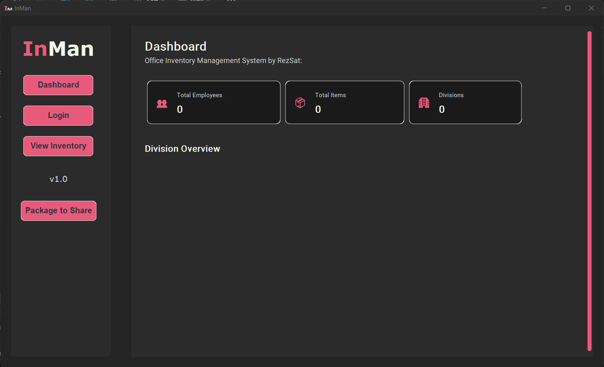

# InMan

> **Latest stable: [InMan 2.0.0 — Native Rust](https://github.com/RezSat/InMan/releases/tag/v2.0.0).** The Rust desktop application lives in [`rust/`](rust/README.md). It preserves the SQLite inventory format, product-key activation, management workflows, reports, original branding, and now includes a focused Inventory results view and fully scrollable Division overview. Its optimized Windows release runs through Rust regression tests, Clippy and native GUI startup/relaunch checks before publication.
>
> **Legacy fallback:** [Python v1.4](https://github.com/RezSat/InMan/releases/tag/v1.4) remains available. The Python setup and implementation documentation below describes that older release. For v2.0 installation, development and display settings, use the [Rust README](rust/README.md). Make an external backup of `inventory.db` before upgrading.

Windows desktop inventory manager for tracking office assets, employee assignments, divisions and asset transfers.

Built with Python, CustomTkinter, SQLAlchemy, SQLite and openpyxl. The interface intentionally stays familiar across the 1.4 internal refactor: same navigation, palette, buttons, dialogs and report formats.



## What it does

**View Inventory:** search by employee, item name, division, unique key or employee item. Employee-item searches support attribute name/value filtering. Search results can be exported to Excel.

**Manager Tools:**

| Area | Available actions |
| --- | --- |
| Inventory | Add item types, update details, remove individual/bulk items, view records |
| Employees | Add, bulk import from spreadsheets, update names/IDs/attributes, remove individual/bulk employees, view employees and their assets |
| Divisions | Create, update, remove individual/bulk divisions, view division structure |
| Assignments | Assign item instances to employees, transfer assets between employees |
| Reports | Division-wise inventory, employees, and item-type exports to Excel |

Other functionality includes the dashboard, manager login, product-key activation, transfer history, audit logs and the sidebar's Package to Share action. The code retains an asset-assignment log view and a backup function, even though they are not currently exposed on the main Manager Tools menu.

The [feature map](docs/feature-map.md) documents the existing screens, button labels, data contracts and v1.4 compatibility requirements.

## Requirements

- Windows (uses the Windows registry for product-key activation).
- Python 3.11 for development and CI.
- SQLite (provided by Python); no database server required.
- Project dependencies listed in `requirements.txt`.

The distributed Windows executable bundles the Python runtime. You do not need Python installed to run a release binary.

## Run from source

```powershell
git clone https://github.com/RezSat/InMan.git
cd InMan
py -3.11 -m venv .venv
.\.venv\Scripts\Activate.ps1
python -m pip install -r requirements.txt
python main.py
```

Activation still follows the existing product-key flow. It is not removed or bypassed by the refactor.

## Database

The application uses `sqlite:///inventory.db`, resolved relative to the **process working directory**, not automatically the executable's folder. Normally that is the folder from which InMan is launched.

Database tables:

- `divisions` — division identity
- `employees` — employees and assigned division
- `items` — available item types
- `employee_items` — assigned physical item instances and their unique keys
- `employee_item_attributes` — name/value attributes per assignment
- `users` — manager accounts
- `logs` — action log
- `item_transfer_history` — asset transfer records

**Data protection:** shut down InMan and make a backup of `inventory.db` before changing versions or editing data. Keep real customer databases, logins and asset reports out of public Git history.

The v1.4 refactor does not rename tables or columns or require a migration from v1.3.2. Employee deletion is blocked when items are still assigned; transfer or remove those assignments first. Search handles older records with missing employee relationships without crashing.

The old v1.3.2 source is retained at [`old/v1.3.2`](https://github.com/RezSat/InMan/tree/old/v1.3.2).

## Development and testing

```powershell
python -m compileall -q controllers models gui utils tests main.py
python -m unittest discover -s tests -v
```

Automated tests run against in-memory SQLite and check:

- Employee assignments, ownership relationships and safe employee deletion.
- Employee/item search results, attributes and missing employee links.
- Dashboard counts and employee inventory payloads.
- Query budgets that prevent repeated database lookups per employee/asset.
- Bulk selection state, visible menu options, color palette and executable icon.

A green CI build is not equivalent to exercising every screen manually. Before shipping UI or database changes, run the [desktop smoke-test checklist](docs/desktop-smoke-test.md) using a **copy** of a representative database.

## Build a Windows executable

```powershell
python -m PyInstaller --noconfirm --clean --onefile --windowed --collect-all customtkinter --icon assets/CustomTkinter_icon_Windows.ico --name InMan main.py
```

The output is `dist/InMan.exe`. The original pink-and-cream IM icon comes from `assets/CustomTkinter_icon_Windows.ico`, not `assets/icon.ico`.

The GitHub Actions workflow `.github/workflows/windows-release.yml` runs tests, compiles the source and builds the same EXE on Windows. A merge into `main` with the designated `release: v1.4` commit title publishes the artifact as the v1.4 release. Other commits do not publish a release.

**Code signing:** CI currently does not apply an Authenticode signature. Unsigned downloads can produce Microsoft Defender SmartScreen reputation warnings. The icon choice and the signature are unrelated.

## Project layout

```text
main.py                  Windows activation and application startup
config.py                Canonical UI palette
models/
  database.py            SQLAlchemy engine, sessions and initialization
  models.py              ORM schema
controllers/
  auth.py                Manager authentication
  crud.py                Inventory and assignment operations
utils/
  search.py              Search/filter queries
  summary.py             Report generation and Excel exports
gui/
  ui.py                  Application navigation
  sidebar.py             Navigation and packaging
  dashboard.py           Dashboard cards
  inventory.py           Search and result rendering
  login.py               Manager login
  manager.py             Manager Tools navigation
  tools/                 Individual management screens
tests/                   SQLite and UI contract tests
docs/                    Feature map and desktop acceptance checklist
.github/workflows/       Windows test, package and release pipeline
```

## Performance work in 1.4

- Inventory reads fetch related assignments and attributes in batches, instead of issuing queries for each employee and item.
- Division totals are computed with grouped SQL queries instead of a query for each division.
- Employee and assigned-item searches preload relationships and avoid repeated lookups.
- The inventory search keeps search controls mounted between searches instead of rebuilding the entire view.
- SQL statement echoing is disabled in normal application runs.
- Common bulk-selection and view-cleanup behavior is shared between screens.

These changes are internal. The color scheme, labels, desktop layout and user workflows are not being redesigned.

## Release history

- **v1.3.2** — restored the classic IM executable icon.
- **v1.3.1** — prevent orphan assignment failures in Employee Items search; block deleting employees with assigned assets.
- **v1.4** — internal refactor and query optimization. Release only after automated and desktop compatibility validation.

Release downloads: [GitHub Releases](https://github.com/RezSat/InMan/releases).
